# Flash-Sale Ticket Booking — Lộ trình học tối ưu hệ thống

Bán **1.000 vé** cho **50.000 người** vào cùng lúc. Chạy **native, không Docker**.

> Mục tiêu không phải xây xong hệ thống, mà là **đo được** tác động của từng thay đổi.

### Nguyên tắc
1. Không tối ưu trước khi đo được → mọi thay đổi phải có số before/after.
2. Một thay đổi một lần → đổi 3 thứ cùng lúc thì không biết thứ nào có tác dụng.
3. `oversell == 0` là bất khả xâm phạm. Nhanh mà sai = vô nghĩa.
4. Tải nhỏ không có bài học → data phải lớn hơn mức RAM cache được.
5. Ghi cả thất bại → tối ưu không hiệu quả là entry giá trị nhất.

### SLO đích
| Chỉ số | Baseline (Phase 1) | Đích |
|---|---|---|
| `POST /reservations` p99 | ~10.000 ms | **< 200 ms** |
| Throughput | ~200 rps | **> 5.000 rps** |
| Oversell | ? | **0** |
| Error rate 5xx | > 40% | **< 0.1%** |
| GC pause p99 | — | **< 10 ms** |
| Frontend LCP (Slow 3G) | — | **< 2.5 s** |

---

# PHẦN I — HIGH LEVEL DESIGN

## Kiến trúc đích (cuối Phase 8)

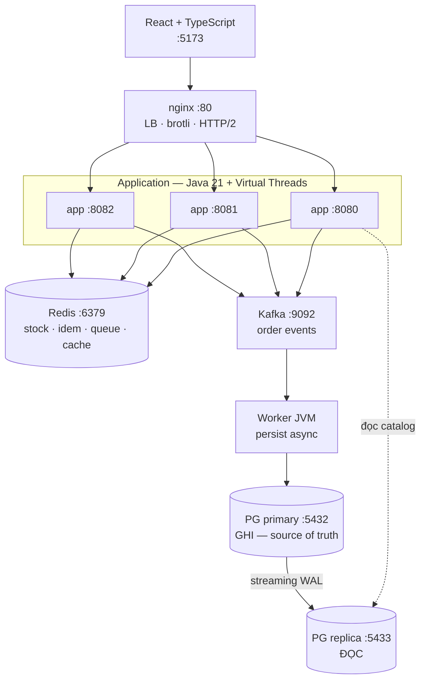

## Tầng đo lường (song song, không nằm trên hot path)

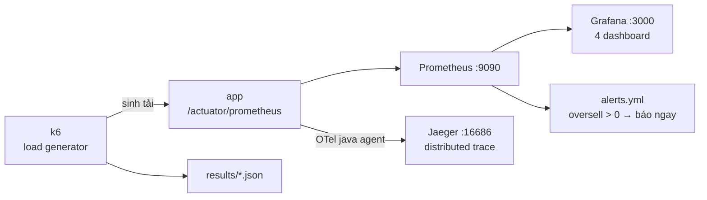

## Vai trò từng thành phần

| Thành phần | Vai trò | Vào từ phase |
|---|---|---|
| Spring Boot app | API, hot path `POST /reservations` | 1 |
| PostgreSQL primary | Source of truth, giữ invariant bằng CHECK constraint | 1 |
| PG replica | Tách tải đọc khỏi ghi | 2 |
| Redis | Bộ đếm tồn atomic, idempotency, cache, hàng chờ | 3-5 |
| Kafka + Worker | Đẩy persist ra khỏi hot path | 5 |
| nginx | LB, nén, HTTP/2 | 8 |
| Prometheus/Grafana/Jaeger | Đo lường — **điều kiện tiên quyết** | 0 |

## Bản đồ bottleneck — mỗi phase tấn công một nghẽn

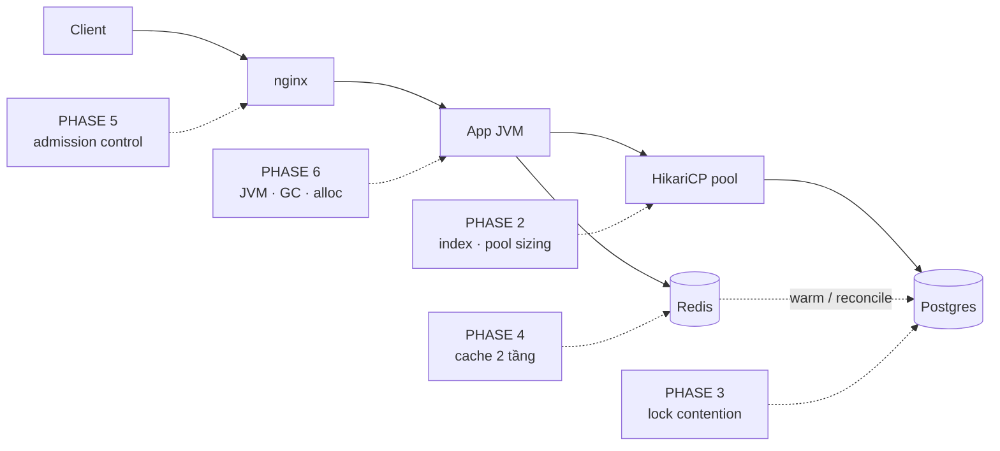

| # | Nghẽn | Biểu hiện trên Grafana | Phase |
|---|---|---|---|
| 1 | N+1 query, thiếu index | DB query time cao, QPS cao bất thường | 2 |
| 2 | Pool cạn | `hikaricp_connections_pending` > 0 | 2 |
| 3 | Lock trên 1 row inventory | p99 tăng tuyến tính theo concurrency | 3 |
| 4 | Đọc catalog đập vào DB | DB QPS cao, cache hit thấp | 4 |
| 5 | Nhận quá nhiều request | queue vô hạn, timeout cascade | 5 |
| 6 | GC pause | p99 răng cưa đúng nhịp GC | 6 |
| 7 | Shared bottleneck | thêm instance mà throughput không tăng | 8 |

## Phụ thuộc giữa các phase

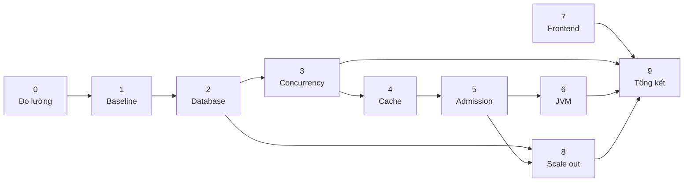

Đường tối giản khi thiếu thời gian: **0 → 1 → 2 → 3 → 9**.

---

# PHẦN II — DETAILED DESIGN

## Schema (PostgreSQL)

```sql
CREATE TABLE events (
  id              BIGSERIAL PRIMARY KEY,
  name            TEXT        NOT NULL,
  venue           TEXT        NOT NULL,
  starts_at       TIMESTAMPTZ NOT NULL,
  sale_starts_at  TIMESTAMPTZ NOT NULL,
  status          SMALLINT    NOT NULL   -- 0 DRAFT 1 ON_SALE 2 SOLD_OUT 3 CLOSED
);

CREATE TABLE ticket_types (
  id          BIGSERIAL PRIMARY KEY,
  event_id    BIGINT NOT NULL REFERENCES events(id),
  name        TEXT   NOT NULL,
  price_cents BIGINT NOT NULL
);

-- Tách inventory khỏi ticket_types: đây là HOT ROW.
-- Update counter không được chặn hàng nghìn request đang đọc name/price.
CREATE TABLE inventory (
  ticket_type_id BIGINT PRIMARY KEY REFERENCES ticket_types(id),
  total          INT    NOT NULL,
  reserved       INT    NOT NULL DEFAULT 0,
  sold           INT    NOT NULL DEFAULT 0,
  version        BIGINT NOT NULL DEFAULT 0,          -- optimistic lock (Phase 3.2)
  CONSTRAINT no_oversell CHECK (reserved + sold <= total)   -- invariant ở tầng DB
);

CREATE TABLE reservations (
  id              BIGSERIAL PRIMARY KEY,
  idempotency_key UUID        NOT NULL UNIQUE,       -- chống double-booking khi retry
  user_id         BIGINT      NOT NULL,
  ticket_type_id  BIGINT      NOT NULL REFERENCES ticket_types(id),
  qty             INT         NOT NULL CHECK (qty BETWEEN 1 AND 4),
  status          SMALLINT    NOT NULL,              -- 0 HELD 1 CONFIRMED 2 EXPIRED 3 CANCELLED
  expires_at      TIMESTAMPTZ NOT NULL,
  created_at      TIMESTAMPTZ NOT NULL DEFAULT now()
);

CREATE TABLE orders (
  id             BIGSERIAL PRIMARY KEY,
  reservation_id BIGINT      NOT NULL UNIQUE REFERENCES reservations(id),
  user_id        BIGINT      NOT NULL,
  amount_cents   BIGINT      NOT NULL,
  status         SMALLINT    NOT NULL,               -- 0 PENDING 1 PAID 2 FAILED
  created_at     TIMESTAMPTZ NOT NULL DEFAULT now()
);
```

**`CHECK (reserved + sold <= total)` là điểm thiết kế quan trọng nhất.** Dù Redis sai, code sai, race condition — Postgres vẫn từ chối. Defense in depth: tối ưu hung ở tầng trên, invariant giữ chặt ở tầng dưới.

## Quan hệ dữ liệu

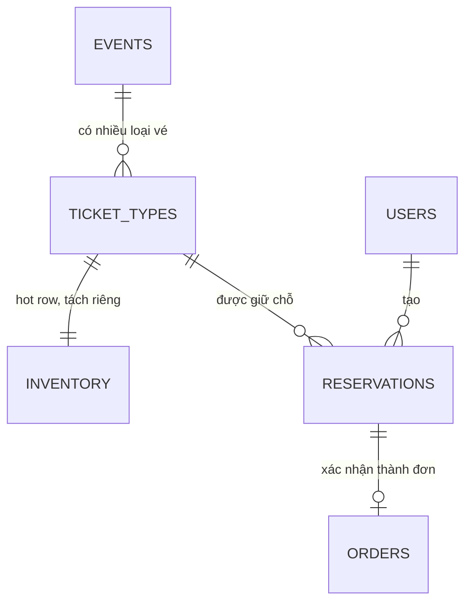

## Kế hoạch index (thêm dần ở Phase 2 — đo từng cái)

| Index | Phục vụ | Loại | Ghi chú |
|---|---|---|---|
| `ticket_types(event_id)` | list vé của event | btree | sửa N+1 |
| `reservations(idempotency_key)` | tra idempotency | unique | có sẵn qua UNIQUE |
| `reservations(status, expires_at)` | job dọn HELD hết hạn | **partial** `WHERE status=0` | chỉ index phần nóng |
| `orders(user_id, id DESC)` | lịch sử đơn, keyset pagination | composite | thay cho OFFSET |
| `events(status, sale_starts_at)` | trang chủ | composite | thứ tự cột quan trọng |

Mỗi index đo **2 chiều**: đọc nhanh hơn bao nhiêu **và** ghi chậm đi bao nhiêu %.

## Redis key design

| Key | Type | TTL | Dùng để |
|---|---|---|---|
| `stock:{ttId}` | STRING (int) | ∞ | Bộ đếm tồn, giảm atomic qua Lua |
| `idem:{key}` | STRING | 24h | → reservationId, chống retry trùng |
| `hold:{resId}` | STRING | 600s | Giữ chỗ; key expire → trả vé |
| `queue:{eventId}` | ZSET | — | Hàng chờ, score = epoch ms |
| `rl:{userId}` | STRING | 1s | Token bucket rate limit |
| `event:{eventId}` | HASH | 60s ± jitter | Cache catalog (jitter chống stampede) |

## Thuật toán giữ chỗ atomic (Phase 3.4)

Một round-trip, atomic, idempotent:

```lua
-- reserve.lua
-- KEYS[1]=stock:{ttId}  KEYS[2]=idem:{key}
-- ARGV[1]=qty  ARGV[2]=reservationId  ARGV[3]=idemTtlSec
local prev = redis.call('GET', KEYS[2])
if prev then return {1, prev} end                      -- 1 = trùng, trả kết quả cũ

local stock = tonumber(redis.call('GET', KEYS[1]))
if stock == nil then return {-2, ''} end               -- -2 = cache chưa warm
if stock < tonumber(ARGV[1]) then return {-1, ''} end  -- -1 = hết vé

redis.call('DECRBY', KEYS[1], ARGV[1])
redis.call('SET', KEYS[2], ARGV[2], 'EX', ARGV[3])
return {0, ARGV[2]}                                    -- 0 = ok
```

Vì sao Lua: `GET` rồi `DECRBY` từ phía client **không** atomic → oversell. Lua chạy single-threaded trong Redis → atomic mà không cần lock.

## Luồng giữ chỗ (đích, sau Phase 5)

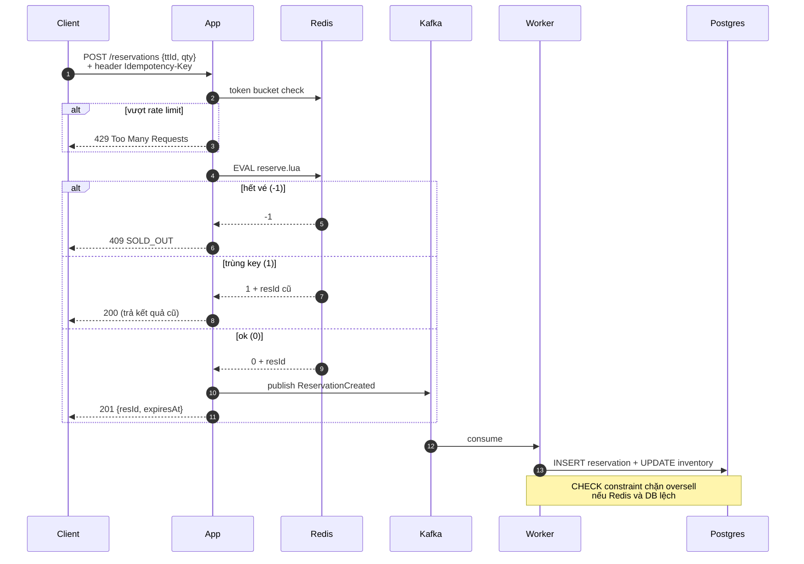

Điểm then chốt: client nhận `201` **trước khi** DB ghi xong → đánh đổi latency ↔ consistency. Đây là lý do bắt buộc phải có reconciliation job.

## State machine của Reservation

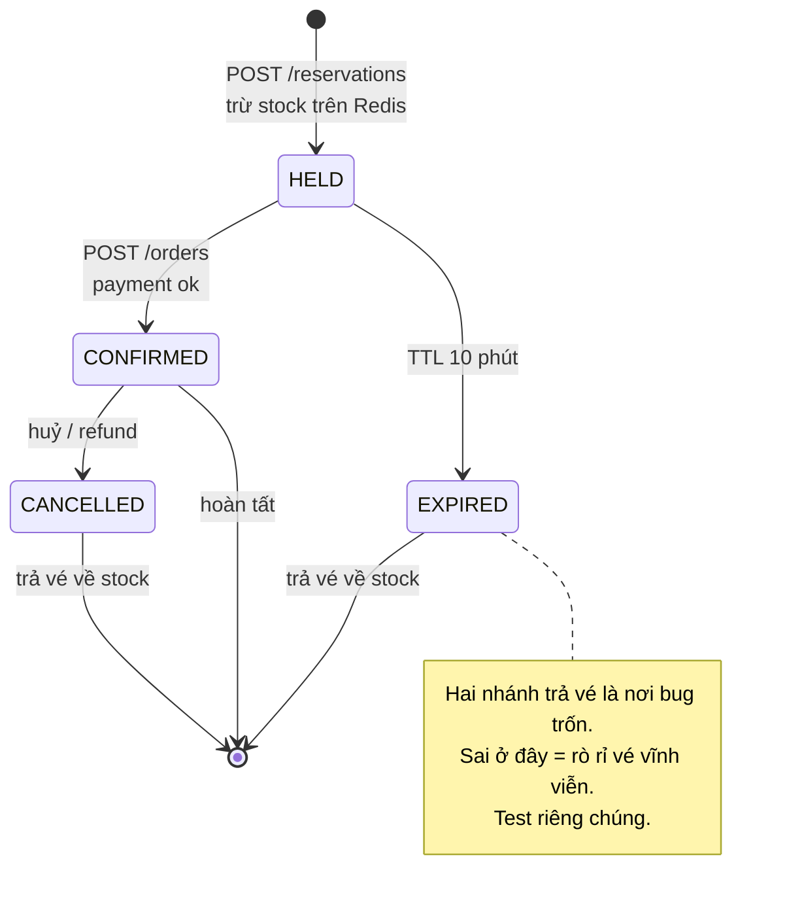

## API contract

| Method | Path | Body / Query | Trả | Ghi chú |
|---|---|---|---|---|
| GET | `/events` | `?cursor&limit` | `{items[], nextCursor}` | keyset pagination, cache 60s |
| GET | `/events/{id}` | — | event + ticketTypes + tồn | cache 60s + jitter |
| POST | `/reservations` | `{ttId, qty}` + `Idempotency-Key` | `201 {resId, expiresAt}` | **hot path**, 409 nếu hết |
| POST | `/orders` | `{resId, paymentToken}` | `201 {orderId}` | xác nhận giữ chỗ |
| GET | `/queue/{eventId}/position` | — | `{position, etaSec}` | SSE ở Phase 5 |
| GET | `/actuator/prometheus` | — | metrics | Prometheus scrape |

## Metrics phải có (Phase 0 dựng, mọi phase dùng)

| Metric | Type | Đọc để biết |
|---|---|---|
| `http_server_requests_seconds` | histogram | RED: rate, error, duration p99 |
| `reservation_attempts_total{result}` | counter | ok / soldout / duplicate / ratelimited |
| `inventory_oversell_total` | counter | **phải luôn = 0** → alert ngay |
| `reservation_leaked_total` | counter | vé mất do nhánh trả vé lỗi |
| `redis_script_duration_seconds` | histogram | Lua có thành nghẽn chưa |
| `hikaricp_connections_pending` | gauge | > 0 = pool cạn |
| `jvm_gc_pause_seconds` | histogram | p99 răng cưa do GC |
| `cache_requests_total{tier,result}` | counter | hit rate từng tầng |
| `kafka_consumer_lag` | gauge | worker có theo kịp |

---

# PHẦN III — CÁC GIAI ĐOẠN

## PHASE 0 — Hạ tầng đo lường  `1 tuần`

> Làm **trước** khi viết dòng business logic nào. Cắt phase này = mất cả dự án.

**Đã có trên máy:** Java 21, Maven 3.8, PostgreSQL 16, Redis 7, Node 18, make, git.
**Cần thêm:** k6, Prometheus, Grafana, Jaeger, async-profiler → binary vào `tools/` (Phụ lục A).

**Làm gì**
- [ ] `scripts/install-tools.sh` + `scripts/stack.sh {up|down|status}`
- [ ] Spring Boot + `actuator` + `micrometer-registry-prometheus`
- [ ] OTel java agent → Jaeger
- [ ] 4 Grafana dashboard: **RED** · **JVM** · **DB+Redis** · **Business** (oversell, leaked, soldout)
- [ ] 4 k6 script:

| Script | Hình dạng tải | Tìm ra |
|---|---|---|
| `smoke.js` | 1 VU, 1 phút | API không lỗi |
| `load.js` | ramp → 500 VU, giữ 10 phút | throughput bền |
| `spike.js` | **0 → 50.000 VU trong 10s** | hành vi flash-sale thật |
| `soak.js` | 200 VU, 1 giờ | memory leak, connection leak |

- [ ] `make bench` → chạy k6 + lưu JSON vào `results/`
- [ ] async-profiler xuất được flame graph HTML

**Exit:** một lệnh → sinh tải → Grafana hiện p50/p95/p99, error rate, pool, GC.

---

## PHASE 1 — Bản ngây thơ + Baseline  `3-4 ngày`

> Cố tình viết tệ. **Biết sai mà không sửa** là phần của bài học.

**Làm gì**
- [ ] JPA entity + `JpaRepository` + service `@Transactional`
- [ ] Giữ chỗ bằng `SELECT ... FOR UPDATE` trên row inventory
- [ ] Không index ngoài PK, không cache, trả full entity
- [ ] Seed: **2M users, 1.000 events, 5M orders** (ghi chú dung lượng ở Phụ lục A)
- [ ] Hạ `shared_buffers` → 256MB, buộc data lớn hơn cache để thấy IO thật
- [ ] Chạy `spike.js` → `results/baseline.md`
- [ ] Flame graph CPU + allocation tại tải đỉnh

**Số liệu dự kiến:** p99 > 10s · ~200 rps rồi sập · error > 40% · `pending` hàng nghìn · deadlock > 0

**Exit:** `results/baseline.md` có bảng số + flame graph + screenshot Grafana.

---

## PHASE 2 — Tầng Database  `1.5 tuần`

> 80% cải thiện dễ nhất nằm ở đây. Làm trước khi nghĩ đến cache.

**Làm gì**
- [ ] `EXPLAIN (ANALYZE, BUFFERS)` mọi query hot path — đọc seq vs index scan, rows **estimate vs actual**
- [ ] Đếm query/request (`hibernate.generate_statistics` / `datasource-proxy`) → lộ N+1
- [ ] Sửa N+1 **3 cách, đo cả 3**: `JOIN FETCH` · `@EntityGraph` · **DTO projection**
- [ ] Thêm index theo bảng Phần II — đo cả chiều đọc và chiều ghi
- [ ] `OFFSET` → **keyset pagination**; đo trang 1 vs trang 10.000
- [ ] Pool sizing: tính bằng Little's Law, rồi **đo thực** pool = 5/10/20/50/100 → vẽ đồ thị
- [ ] PG replica :5433 (`pg_basebackup` + streaming) + `AbstractRoutingDataSource`
- [ ] DTO gọn thay entity → đo byte/response

**Exit:** query/request của `GET /events` từ N+1 về hằng số; pool size tối ưu tìm **bằng số liệu**.

**Bài học:** pool lớn hơn ≠ nhanh hơn. Hiểu *tại sao* là insight quan trọng nhất phase này.

---

## PHASE 3 — Concurrency & Correctness  `2 tuần`  ⭐

> Phase giá trị nhất. Thử **tuần tự 5 chiến lược, đo từng cái**, rồi so sánh.
> Thiết kế code: 1 interface `ReserveStrategy` + 5 implementation → đổi bằng config, A/B dưới cùng tải.

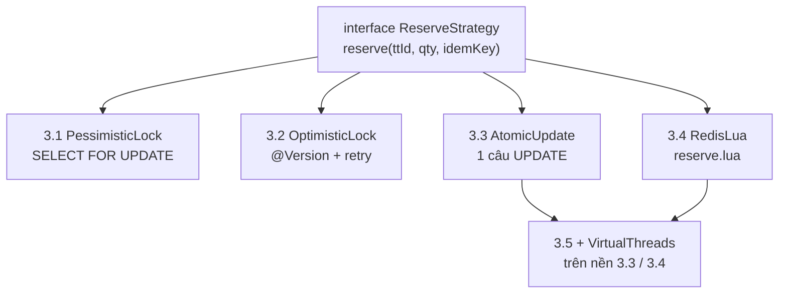

| # | Chiến lược | Dự kiến thấy gì |
|---|---|---|
| 3.1 | Pessimistic — `SELECT FOR UPDATE` | mọi request serialize trên 1 row → throughput chặn cứng |
| 3.2 | Optimistic — `@Version` | contention cao → bão retry → **tệ hơn** 3.1 |
| 3.3 | Atomic UPDATE — 1 câu lệnh | thường là **winner ở tầng DB** |
| 3.4 | Redis + Lua | nhanh nhất, nhưng sinh bài toán consistency |
| 3.5 | Virtual threads | **không** cứu được pool đang cạn |

```sql
-- 3.3: không round-trip, lock cực ngắn, invariant nằm trong WHERE
UPDATE inventory SET reserved = reserved + :qty
WHERE ticket_type_id = :id AND reserved + sold + :qty <= total;
-- rowsAffected = 0  →  hết vé
```

**Làm thêm ở 3.4**
- [ ] Idempotency end-to-end: header → `idem:` → unique constraint DB
- [ ] Reconciliation job: Redis ↔ DB lệch thì **ai thắng**? Viết rõ quy tắc.
- [ ] Nhánh trả vé: `EXPIRED` (Redis keyspace notification) và `CANCELLED`

**Chaos test (native)**
- [ ] `sudo systemctl stop redis-server` giữa tải đỉnh → oversell? mất vé?
- [ ] `kill -STOP <app-pid>` rồi `-CONT` → request đang bay ra sao?
- [ ] `sudo tc qdisc add dev lo root netem delay 200ms` → DB chậm đột ngột

**Ở 3.5:** đo platform vs virtual thread cùng workload; tìm pinning bằng `-Djdk.tracePinnedThreads=full`

**Exit:** `oversell == 0` dưới **mọi** test kể cả chaos + `results/phase-03/strategy-comparison.md` (throughput / p99 / correctness / độ phức tạp) + nêu rõ chọn cái nào và **tại sao**.

---

## PHASE 4 — Tầng Cache  `1 tuần`

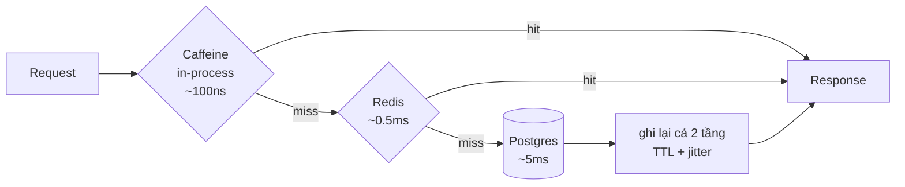

**Làm gì**
- [ ] 2 tầng Caffeine → Redis → DB; đo hit rate + latency **từng tầng**
- [ ] **Stampede**: cho TTL hết đồng loạt dưới tải → xem DB sập. Sửa 2 cách, đo cả 2: single-flight lock · probabilistic early expiration
- [ ] **Hot key**: 1 event chiếm 90% traffic → local cache + TTL jitter
- [ ] **Penetration**: negative cache + bloom filter cho ID không tồn tại
- [ ] Invalidation: TTL-only vs write-through vs event-driven → đo **staleness** từng cách

**Exit:** hit rate catalog > 95%, DB QPS giảm > 10×, **không** stampede khi chủ động gây ra.

---

## PHASE 5 — Admission Control & Degradation  `1.5 tuần`

> Hệ thống tốt không phải không bao giờ quá tải, mà **suy giảm có kiểm soát**.

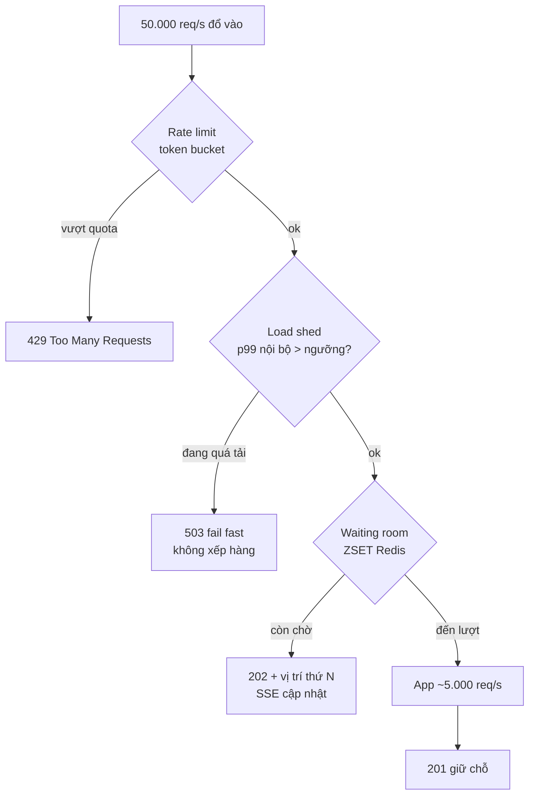

**Làm gì**
- [ ] Token bucket (Bucket4j + Redis) theo user **và** theo IP
- [ ] Virtual waiting room: ZSET + API vị trí + **SSE** push
- [ ] Load shedding: p99 nội bộ > ngưỡng → 503 **nhanh**
- [ ] Resilience4j: circuit breaker + bulkhead + **timeout ở mọi call ra ngoài**
- [ ] Kafka (KRaft, không ZooKeeper): API chỉ enqueue → đo p99 giảm bao nhiêu
- [ ] Idempotent consumer + poison message + đo consumer lag

**Exit:** ở tải **10× công suất**: không sập, error rate có kiểm soát, người đã vào vẫn trong SLO.

**Bài học:** hàng chờ vô hạn luôn tệ hơn từ chối sớm.

---

## PHASE 6 — JVM & Runtime  `1 tuần`

> Làm **sau cùng** ở backend. Đây là 5-10% cuối, không phải chỗ bắt đầu.

**Làm gì**
- [ ] GC: **G1 vs ZGC vs Parallel** cùng workload → đo pause p99 + throughput
- [ ] Heap sizing: nhỏ → GC liên tục; lớn → pause dài. Tìm điểm tối ưu bằng đo
- [ ] Allocation flame graph → hot allocation (thường: entity không cần, boxing, String concat, Stream trong hot loop)
- [ ] Chi phí Jackson → thử DTO phẳng / `@JsonInclude` / writer thủ công
- [ ] JFR ở profile `bench` → lock contention + IO wait
- [ ] Virtual thread pinning: `-Djdk.tracePinnedThreads=full`

**Exit:** GC pause p99 < 10ms, allocation rate giảm có số liệu, flame graph before/after rõ.

---

## PHASE 7 — Frontend (React + TS)  `1 tuần`

> Tối ưu frontend là vấn đề **network + render**, không phải thuật toán JS.

**Làm gì**
- [ ] Lighthouse baseline + `web-vitals` → gửi backend → Grafana (đo người thật, không đo máy dev)
- [ ] `rollup-plugin-visualizer` → dep nặng vô ích (moment, lodash full, icon set đầy đủ)
- [ ] Code splitting theo route + lazy load → đo lại bundle & LCP
- [ ] React Profiler tìm re-render vô ích → áp `memo`/`useMemo` **và đo xem có nhanh hơn thật không** (thường là không — đây là bài học)
- [ ] Virtual scrolling (`@tanstack/react-virtual`)
- [ ] TanStack Query: cache, stale-while-revalidate, **optimistic update** cho nút giữ chỗ
- [ ] nginx brotli + HTTP/2 · so sánh SSE vs polling cho hàng chờ
- [ ] Test với **CPU throttle 4× + Slow 3G**

**Exit:** LCP < 2.5s, INP < 200ms **dưới throttle**; bundle initial < 200KB gzip.

---

## PHASE 8 — Scale Out & Resilience  `1 tuần`

**Làm gì**
- [ ] 4 JVM (`--server.port=8080..8083`) sau nginx upstream
- [ ] Kiểm stateless: session, cache local, **scheduled job chạy trùng 4 lần**
- [ ] Tính lại pool: 4 × 20 = 80 connection — PG `max_connections` chịu nổi?
- [ ] Partition `orders` theo thời gian (`PARTITION BY RANGE (created_at)`)
- [ ] Scale test 1 → 2 → 3 → 4 instance

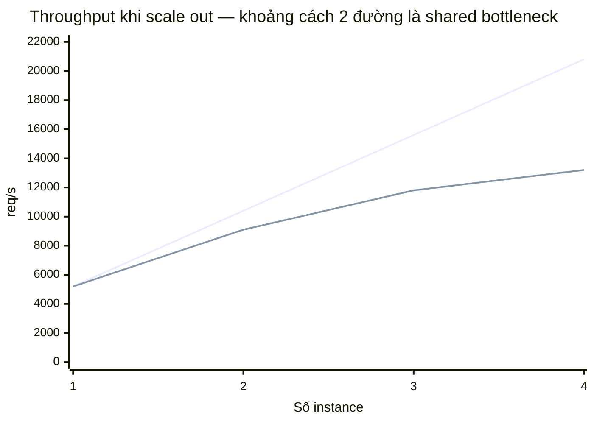

Đường trên = tuyến tính lý tưởng. Đường dưới = thực tế. **Nhiệm vụ của bạn: chỉ ra chính xác cái gì tạo ra khoảng cách đó** (Amdahl / Universal Scalability Law).

- [ ] Chaos native: `systemctl stop redis-server` · `kill -STOP` 1 instance · `tc netem delay/loss` · `systemd-run -p MemoryMax=512M`

**Exit:** giải thích được **bằng số liệu** đâu là shared bottleneck.

---

## PHASE 9 — Tổng kết  `3 ngày`

> Phase quyết định dự án có giá trị khi đem đi phỏng vấn hay không.

- [ ] `OPTIMIZATION_LOG.md` hoàn chỉnh
- [ ] Bảng tổng baseline → cuối, kèm % cải thiện
- [ ] Mục **"Những tối ưu KHÔNG hiệu quả"** — kỳ vọng gì, thực tế gì, tại sao
- [ ] Grafana snapshot before/after
- [ ] "Nếu làm lại tôi sẽ đổi thứ tự thế nào"

---

# PHỤ LỤC A — Chạy native (không Docker)

### Hai việc phải xử lý trước Phase 1

**1. Disk còn 12GB / 233GB (95% đầy).** Seed đầy đủ (10M users + 50M orders + index) cần ~14GB → **không đủ**.
→ Roadmap đã hạ xuống **2M users / 5M orders** (~1.5GB). Vẫn học được seq-scan vs index-scan nếu hạ `shared_buffers` xuống 256MB.
→ Giải phóng được ~30GB thì nâng lại 10M/50M để thấy IO pattern thật.

**2. Node v18.19** — Vite 5 ok, Vite 6+ cần Node 20+. Trước Phase 7: `nvm install 22`.

### Vì sao native tốt hơn Docker ở dự án này
Docker thêm overlay-fs write penalty, NAT của bridge network, và cgroup accounting — cả ba làm nhiễu số đo. Với dự án mà **số đo chính là sản phẩm**, native cho số sạch hơn. Thêm nữa: `tc netem`, `systemd-run`, `kill -STOP` dạy nhiều hơn `docker kill`.

### Port map

| Thành phần | Port | Chạy bằng |
|---|---|---|
| PG primary | 5432 | systemd *(đang chạy)* |
| PG replica | 5433 | cluster thứ 2 qua `pg_basebackup` |
| Redis | 6379 | systemd *(đang chạy)* |
| App | 8080-8083 | `java -jar ... --server.port=` |
| Prometheus | 9090 | `tools/prometheus/prometheus` |
| Grafana | 3000 | `tools/grafana/bin/grafana server` |
| Jaeger | 16686 | `tools/jaeger/jaeger-all-in-one` |
| Kafka (KRaft) | 9092 | `tools/kafka/bin/kafka-server-start.sh` |
| nginx | 80 | `apt install nginx` + systemd |
| Frontend dev | 5173 | `pnpm dev` |

### Bộ lệnh chaos native

| Tình huống | Lệnh |
|---|---|
| Redis chết | `sudo systemctl stop redis-server` |
| DB chậm 200ms | `sudo tc qdisc add dev lo root netem delay 200ms` |
| Mất 5% packet | `sudo tc qdisc add dev lo root netem loss 5%` |
| **Hoàn tác netem** | `sudo tc qdisc del dev lo root` ← luôn chạy sau test |
| App treo | `kill -STOP <pid>` → `kill -CONT <pid>` |
| Giới hạn CPU 50% | `systemd-run --scope -p CPUQuota=50% java -jar app.jar` |
| Giới hạn RAM | `systemd-run --scope -p MemoryMax=512M java -jar app.jar` |

---

# PHỤ LỤC B — Cấu trúc thư mục

## Tổng quan

```
optimize-system-project/
├── README.md                 # cách chạy, 10 dòng
├── ROADMAP.md                # file này
├── OPTIMIZATION_LOG.md       # nhật ký đo lường — sản phẩm chính
├── Makefile                  # entrypoint duy nhất
├── .gitignore                # tools/ results/*.json target/ node_modules/
│
├── docs/                     # thiết kế & quyết định
├── backend/                  # Spring Boot
├── frontend/                 # React + TS
├── load-test/                # k6
├── scripts/                  # vận hành, seed, chaos
├── observability/            # prometheus + grafana config
├── tools/                    # binary tải về (gitignored)
└── results/                  # số liệu đo — ĐỪNG gitignore phần .md
```

## `docs/` — thiết kế và lý do

```
docs/
├── hld.md                    # trích Phần I
├── lld.md                    # trích Phần II
├── runbook.md               # bật/tắt stack, chaos, khôi phục
└── adr/                      # Architecture Decision Record, mỗi quyết định 1 file
    ├── 0001-tach-inventory-khoi-ticket-types.md
    ├── 0002-chon-atomic-update-thay-pessimistic-lock.md
    ├── 0003-redis-lam-source-of-truth-tam-thoi.md
    └── 0004-ghi-async-qua-kafka.md
```

ADR là thứ phân biệt dự án học tập với dự án nghiêm túc: mỗi file ghi **bối cảnh → các lựa chọn → quyết định → hệ quả**. Viết ngay khi quyết, không viết hồi tố.

## `backend/` — tổ chức theo domain, không theo tầng

```
backend/
├── pom.xml
└── src/
    ├── main/java/com/booking/
    │   ├── BookingApplication.java
    │   │
    │   ├── common/                          # dùng chung, không chứa business
    │   │   ├── config/
    │   │   │   ├── RedisConfig.java
    │   │   │   ├── DataSourceConfig.java    # routing primary/replica (P2)
    │   │   │   ├── CacheConfig.java         # Caffeine + Redis (P4)
    │   │   │   └── VirtualThreadConfig.java # (P3.5)
    │   │   ├── error/
    │   │   │   ├── GlobalExceptionHandler.java
    │   │   │   ├── ApiError.java
    │   │   │   └── SoldOutException.java
    │   │   ├── idempotency/
    │   │   │   ├── IdempotencyKey.java
    │   │   │   └── IdempotencyFilter.java
    │   │   └── metrics/
    │   │       └── BookingMetrics.java      # oversell, leaked, attempts
    │   │
    │   ├── catalog/                         # ĐỌC NHIỀU → nơi học cache (P4)
    │   │   ├── api/
    │   │   │   ├── EventController.java
    │   │   │   └── dto/{EventSummary,EventDetail,CursorPage}.java
    │   │   ├── domain/{Event,TicketType}.java
    │   │   ├── repo/
    │   │   │   ├── EventRepository.java     # JPA
    │   │   │   └── EventQueryDao.java       # native query + projection (P2)
    │   │   └── cache/
    │   │       ├── EventCache.java          # 2 tầng
    │   │       └── StampedeGuard.java       # single-flight (P4)
    │   │
    │   ├── reservation/                     # ★ HOT PATH — trái tim dự án
    │   │   ├── api/
    │   │   │   ├── ReservationController.java
    │   │   │   └── dto/{ReserveRequest,ReserveResponse}.java
    │   │   ├── domain/
    │   │   │   ├── Reservation.java
    │   │   │   ├── ReservationStatus.java
    │   │   │   └── Inventory.java
    │   │   ├── repo/
    │   │   │   ├── ReservationRepository.java
    │   │   │   └── InventoryDao.java        # atomic UPDATE (P3.3)
    │   │   ├── strategy/                    # ★ 5 cách, cùng 1 interface
    │   │   │   ├── ReserveStrategy.java     # interface
    │   │   │   ├── PessimisticLockStrategy.java
    │   │   │   ├── OptimisticLockStrategy.java
    │   │   │   ├── AtomicUpdateStrategy.java
    │   │   │   ├── RedisLuaStrategy.java
    │   │   │   └── README.md                # bảng so sánh + số đo
    │   │   └── expiry/
    │   │       ├── HeldExpiryListener.java  # Redis keyspace notification
    │   │       └── ReleaseJob.java          # quét DB, lưới an toàn
    │   │
    │   ├── order/
    │   │   ├── api/OrderController.java
    │   │   ├── domain/Order.java
    │   │   └── repo/OrderRepository.java
    │   │
    │   ├── admission/                       # P5 — chặn trước khi vào App
    │   │   ├── RateLimitFilter.java         # Bucket4j
    │   │   ├── LoadShedFilter.java          # p99 > ngưỡng → 503
    │   │   └── CircuitBreakerConfig.java
    │   │
    │   ├── queue/                           # P5 — waiting room
    │   │   ├── WaitingRoomService.java      # ZSET
    │   │   └── QueueSseController.java
    │   │
    │   └── worker/                          # P5 — Kafka consumer
    │       ├── ReservationConsumer.java
    │       └── ReconciliationJob.java       # ★ Redis ↔ DB
    │
    ├── main/resources/
    │   ├── application.yml
    │   ├── application-dev.yml
    │   ├── application-bench.yml             # pool, GC flag, JFR on
    │   ├── db/migration/                     # Flyway — schema có version
    │   │   ├── V1__schema.sql
    │   │   ├── V2__indexes_phase2.sql
    │   │   ├── V3__partition_orders.sql
    │   │   └── V4__seed_small.sql
    │   └── redis/
    │       ├── reserve.lua
    │       └── release.lua
    │
    └── test/java/com/booking/
        ├── reservation/
        │   ├── OversellConcurrencyTest.java  # ★ 1000 thread, assert oversell=0
        │   ├── IdempotencyTest.java          # gửi trùng 100 lần → 1 reservation
        │   ├── ExpiryReleaseTest.java        # nhánh trả vé
        │   └── strategy/StrategyBenchmarkTest.java
        └── catalog/StampedeTest.java
```

### Phụ thuộc giữa package

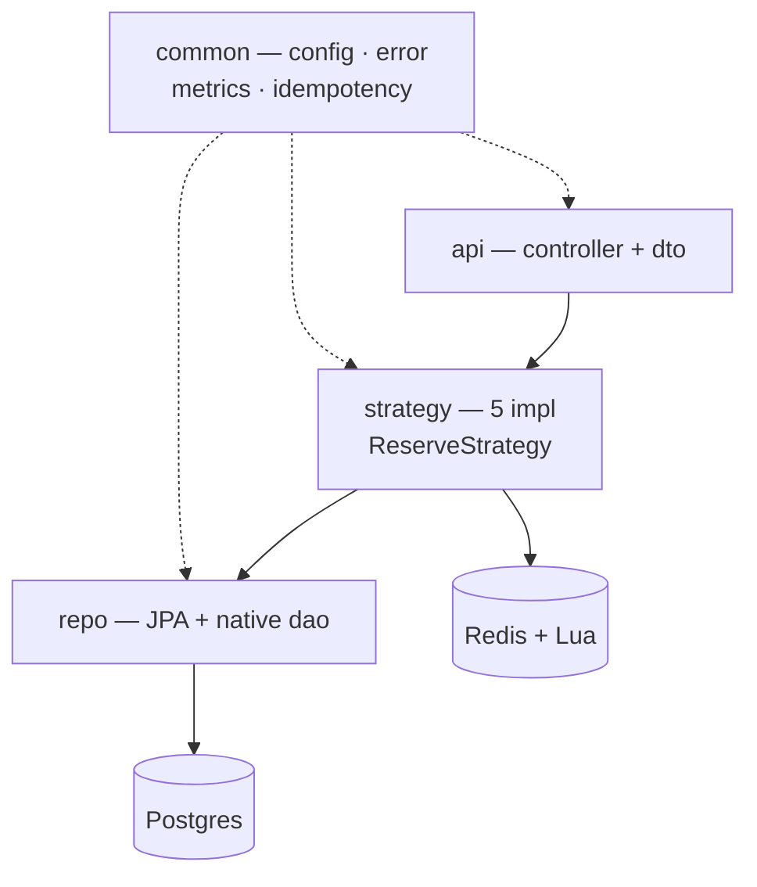

Quy tắc: `common` không được phụ thuộc vào domain nào. `catalog` và `reservation` không gọi nhau trực tiếp.

## `frontend/`

```
frontend/
├── package.json
├── vite.config.ts                 # visualizer + manualChunks (P7)
└── src/
    ├── main.tsx
    ├── api/
    │   ├── client.ts              # fetch wrapper + Idempotency-Key
    │   ├── events.ts
    │   └── reservations.ts
    ├── features/                  # theo tính năng, không theo loại file
    │   ├── event-list/            # virtual scroll (P7)
    │   ├── ticket-picker/
    │   ├── checkout/              # optimistic update (P7)
    │   └── waiting-room/          # SSE (P5)
    ├── lib/
    │   ├── queryClient.ts         # TanStack Query config
    │   └── vitals.ts              # web-vitals → backend
    └── components/                # dùng chung, không chứa logic domain
```

## `load-test/`

```
load-test/
├── lib/
│   ├── config.js                  # BASE_URL, thresholds dùng chung
│   └── helpers.js                 # sinh UUID cho Idempotency-Key
├── scenarios/
│   ├── browse.js                  # đọc catalog (80% traffic)
│   └── reserve.js                 # hot path (20%)
├── smoke.js
├── load.js
├── spike.js                       # ★ bài test thật
└── soak.js
```

Tách `scenarios/` để 4 script chính chỉ khác **hình dạng tải**, không khác logic → so sánh mới công bằng.

## `scripts/`

```
scripts/
├── install-tools.sh               # tải binary vào tools/, in URL + size trước khi tải
├── stack.sh                       # up | down | status
├── bench.sh                       # k6 + lưu results/phase-NN/
├── profile.sh                     # async-profiler attach theo PID
├── pg/
│   ├── tune.sh                    # shared_buffers, max_connections, work_mem
│   ├── setup-replica.sh           # pg_basebackup → :5433
│   ├── seed.sql                   # generate_series, KHÔNG dùng JPA
│   └── explain.sh                 # EXPLAIN ANALYZE + lưu output
└── chaos/
    ├── kill-redis.sh
    ├── slow-db.sh                 # tc netem delay
    ├── drop-packets.sh            # tc netem loss
    ├── freeze-app.sh              # kill -STOP
    └── reset.sh                   # ★ hoàn tác MỌI chaos — chạy sau mỗi test
```

`chaos/reset.sh` quan trọng: `tc` rule tồn tại đến khi reboot. Quên xoá → mọi số đo sau đó sai mà không hiểu vì sao.

## `observability/`

```
observability/
├── prometheus.yml                 # scrape 4 instance app
├── alerts.yml                     # oversell_total > 0 → báo ngay
└── grafana/
    ├── provisioning/
    │   ├── datasources/prometheus.yml
    │   └── dashboards/default.yml  # auto-load, không click tay
    └── dashboards/
        ├── red.json                # rate · error · duration per endpoint
        ├── jvm.json                # heap · GC pause · threads · alloc rate
        ├── db-redis.json           # pool · QPS · cache hit · lua duration
        └── business.json           # oversell · leaked · soldout · queue depth
```

Dashboard `business.json` là cái bạn mở khi chạy `spike.js` — nó trả lời "hệ thống có **đúng** không", còn 3 cái kia trả lời "có **nhanh** không".

## `results/` — đây là sản phẩm, không phải rác

```
results/
├── baseline.md                     # Phase 1 — mốc so sánh
├── phase-02-database/
│   ├── explain/*.txt
│   ├── pool-sizing.csv             # pool size → throughput, p99
│   ├── n+1-before-after.md
│   └── flame-*.html
├── phase-03-concurrency/
│   ├── strategy-comparison.md      # ★ bảng 5 chiến lược
│   └── chaos-oversell-report.md
├── phase-04-cache/
├── ...
└── final-report.md                 # Phase 9
```

`.gitignore` chỉ loại file nhị phân lớn (`*.jfr`, k6 JSON thô). **Giữ lại mọi `.md` và `.csv`** — đó là bằng chứng của dự án.

---

# PHỤ LỤC C — Timeline

| Phase | Thời gian | Bỏ được? |
|---|---|---|
| 0 Đo lường | 1 tuần | ❌ **không** |
| 1 Baseline | 3-4 ngày | ❌ **không** |
| 2 Database | 1.5 tuần | ❌ nhiều cải thiện nhất |
| 3 Concurrency | 2 tuần | ❌ **giá trị cao nhất** |
| 4 Cache | 1 tuần | ✅ |
| 5 Admission | 1.5 tuần | ✅ |
| 6 JVM | 1 tuần | ✅ |
| 7 Frontend | 1 tuần | ✅ |
| 8 Scale out | 1 tuần | ✅ |
| 9 Tổng kết | 3 ngày | ❌ **không** |

**Tổng ~11-12 tuần.** Bản tối giản **0 → 1 → 2 → 3 → 9** (~5.5 tuần) vẫn là dự án tốt.
Cắt Phase 0 thì không đo được gì. Cắt Phase 9 thì không đúc kết được gì.
