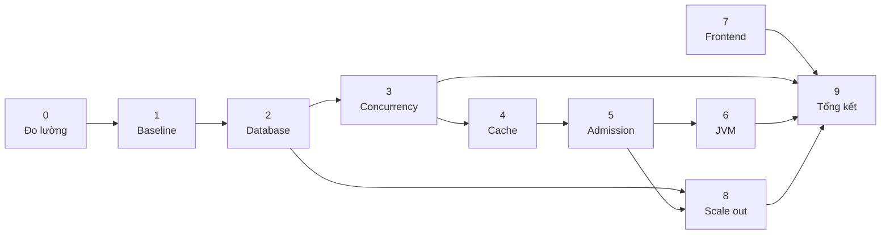

# Lộ trình

> Nội dung chi tiết đã chuyển vào [`docs/`](docs/). File này là **mục lục** —
> mỗi chủ đề có đúng một nơi chứa, không trùng lặp.

## Điểm vào

| Bạn muốn | Đọc |
|---|---|
| Hiểu bài toán & SLO | [docs/01-overview/problem.md](docs/01-overview/problem.md) |
| Hiểu kiến trúc | [docs/02-design/hld.md](docs/02-design/hld.md) |
| Xem sơ đồ (ERD, sequence, state) | [docs/03-diagrams/](docs/03-diagrams/) |
| Bắt đầu làm việc | [docs/04-phases/](docs/04-phases/) |
| Cài đặt máy (không Docker) | [docs/05-runbook/setup-native.md](docs/05-runbook/setup-native.md) |
| Toàn bộ tài liệu | [docs/README.md](docs/README.md) |

## 10 giai đoạn

| Phase | Tên | Thời gian | Bỏ được? | Nghẽn tấn công |
|---|---|---|---|---|
| [00](docs/04-phases/phase-00-observability/) | Hạ tầng đo lường | 1 tuần | ❌ | — (tiên quyết) |
| [01](docs/04-phases/phase-01-baseline/) | Bản ngây thơ + baseline | 3-4 ngày | ❌ | — (mốc so sánh) |
| [02](docs/04-phases/phase-02-database/) | Tầng database | 1,5 tuần | ❌ | index, N+1, pool |
| [03](docs/04-phases/phase-03-concurrency/) | Concurrency & correctness | 2 tuần | ❌ ★ | lock contention |
| [04](docs/04-phases/phase-04-cache/) | Tầng cache | 1 tuần | ✅ | đọc nóng |
| [05](docs/04-phases/phase-05-admission/) | Admission control | 1,5 tuần | ✅ | quá tải |
| [06](docs/04-phases/phase-06-jvm/) | JVM & runtime | 1 tuần | ✅ | GC, allocation |
| [07](docs/04-phases/phase-07-frontend/) | Frontend | 1 tuần | ✅ | network, render |
| [08](docs/04-phases/phase-08-scaleout/) | Scale out | 1 tuần | ✅ | shared bottleneck |
| [09](docs/04-phases/phase-09-report/) | Tổng kết | 3 ngày | ❌ | — (đúc kết) |

**Tổng ~11-12 tuần.** Đường tối giản: **00 → 01 → 02 → 03 → 09** (~5,5 tuần).



Lý do thứ tự: [docs/03-diagrams/phase-dependency.md](docs/03-diagrams/phase-dependency.md)

## Nguyên tắc

1. Không tối ưu trước khi đo được → mọi thay đổi phải có số before/after.
2. Một thay đổi một lần → đổi 3 thứ cùng lúc thì không biết thứ nào có tác dụng.
3. `oversell == 0` là bất khả xâm phạm → nhanh mà sai thì vô nghĩa.
4. Tải nhỏ không có bài học → data phải lớn hơn mức RAM cache được.
5. Ghi cả thất bại → tối ưu không hiệu quả là entry giá trị nhất.

## Cấu trúc repo

```
├── docs/            tài liệu — 7 nhóm, xem docs/README.md
├── backend/         Spring Boot, tổ chức theo domain
├── frontend/        React + TS, tổ chức theo feature
├── load-test/       k6 — 4 hình dạng tải + scenario tách riêng
├── scripts/         vận hành, seed, chaos
├── observability/   prometheus + grafana (provision tự động)
├── tools/           binary tải về (gitignored)
└── results/         số liệu đo — SẢN PHẨM của dự án
```

## Ràng buộc trên máy dev

| | Trạng thái |
|---|---|
| Java 21, Maven, PostgreSQL 16, Redis 7 | ✅ có sẵn, PG/Redis đang chạy |
| Disk | ⚠️ còn 12GB/233GB → seed hạ xuống 2M user / 5M order |
| Node | ⚠️ 18.19, cần ≥20 trước Phase 7 |

Chi tiết + cách bù: [docs/05-runbook/setup-native.md](docs/05-runbook/setup-native.md)
