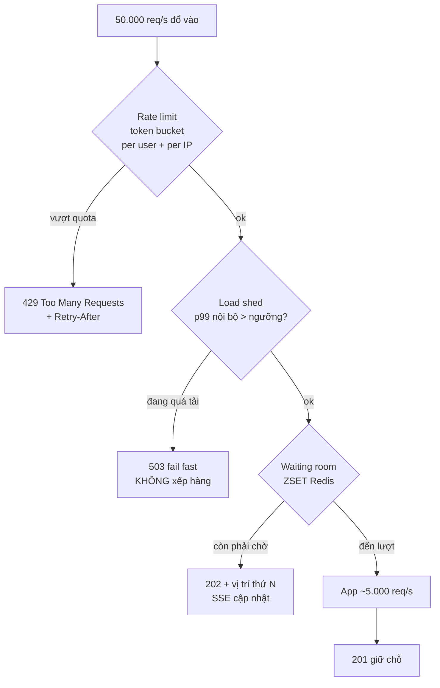
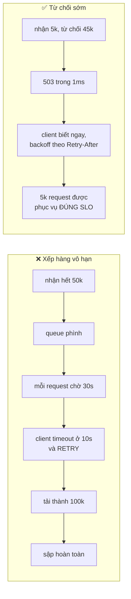
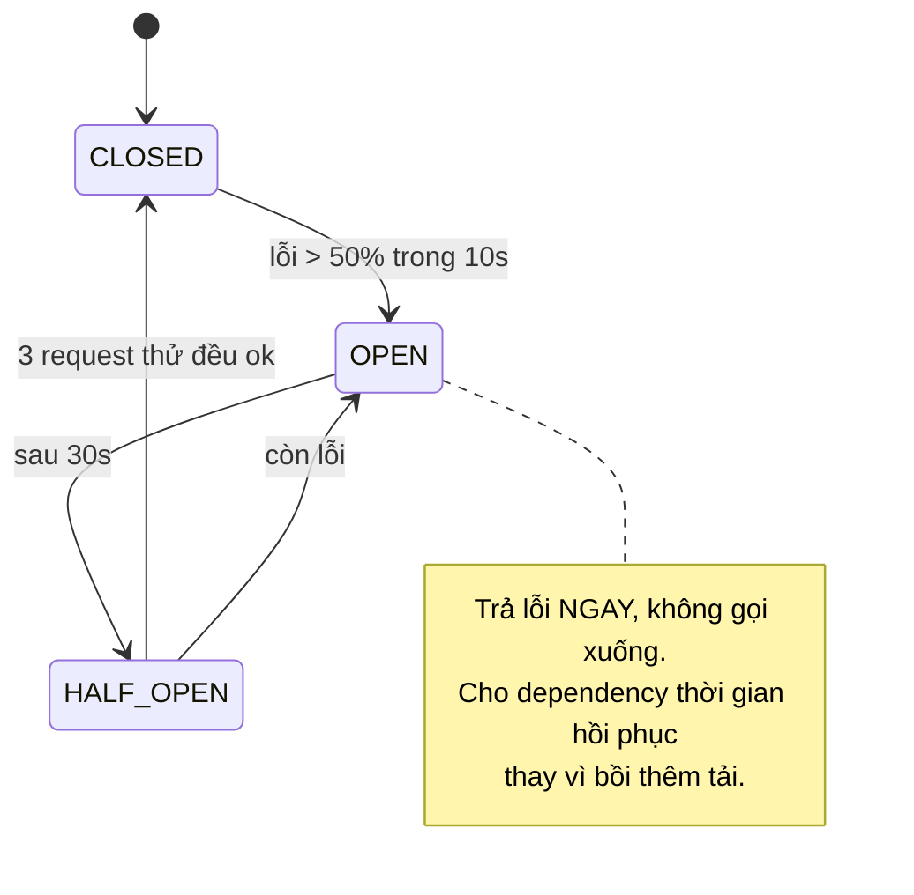

# Phễu điều tiết tải (Phase 5)

Hệ thống tốt không phải hệ thống không bao giờ quá tải, mà là hệ thống **suy giảm có kiểm soát**.



## Thứ tự 3 tầng lọc — không được đổi

| Tầng | Chi phí mỗi request | Vì sao đặt ở đây |
|---|---|---|
| Rate limit | 1 lệnh Redis | Chặn abuse trước, rẻ nhất |
| Load shed | 1 phép so sánh in-memory | Rẻ hơn Redis, nhưng cần rate limit chặn abuse trước |
| Waiting room | 2 lệnh Redis | Đắt nhất, chỉ áp cho request hợp lệ |

Đảo thứ tự → tốn Redis cho cả request abuse. Lọc rẻ trước, đắt sau.

## Vì sao `503` nhanh tốt hơn xếp hàng



Vòng `b4 → b5` là **retry storm** — nguyên nhân phổ biến nhất của sự cố toàn hệ thống.
Chờ lâu hơn timeout của client là tệ hơn từ chối ngay: client vẫn retry, mà bạn đã tốn
tài nguyên xử lý request không ai còn chờ.

## Ngưỡng load shed lấy ở đâu

```
ngưỡng = p99 đo được ở Phase 4 × 1,5
```

Lấy từ số liệu thật của chính hệ thống, không đoán. Phase 4 phải xong trước Phase 5 chính
vì lý do này — không biết công suất thật thì không đặt được ngưỡng.

## Circuit breaker cho dependency



Không có breaker: payment chậm 2s × 1.000 request = pool cạn = **toàn bộ API chết**,
kể cả `GET /events` không liên quan gì đến payment.
