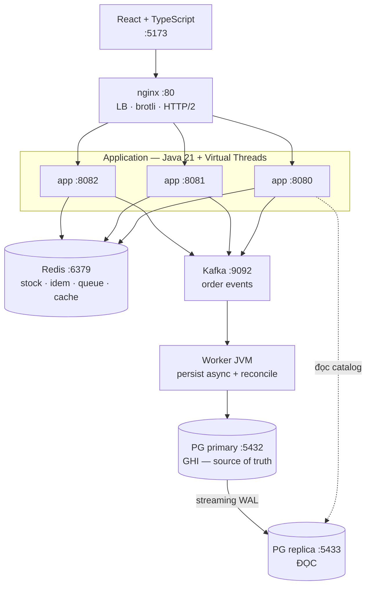
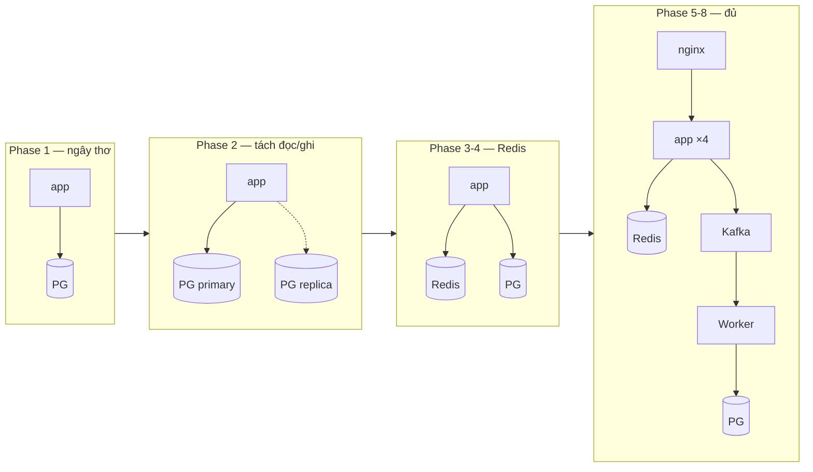
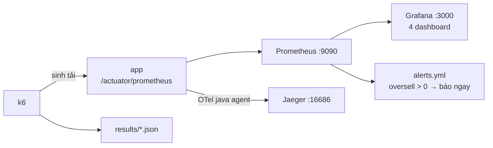

# Kiến trúc hệ thống

## Đích (cuối Phase 8)

## Tiến hoá qua các phase

Mỗi mũi tên là một phase. Đừng dựng kiến trúc cuối ngay từ đầu — bạn sẽ không biết
thành phần nào thực sự cần thiết.

## Tầng đo lường (song song, KHÔNG trên hot path)

Thiết kế có chủ ý: Prometheus chết thì API vẫn chạy. Nếu không như vậy thì tầng đo lường
đã trở thành một nguồn lỗi mới.
