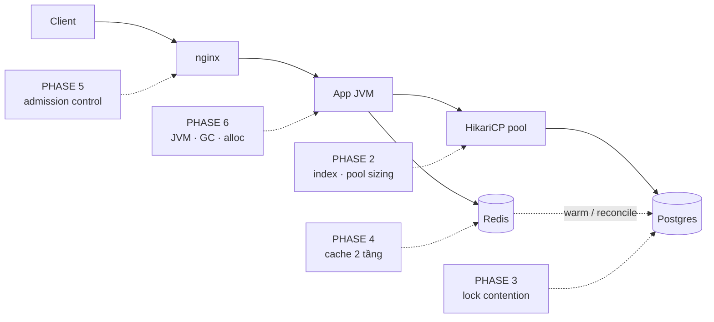
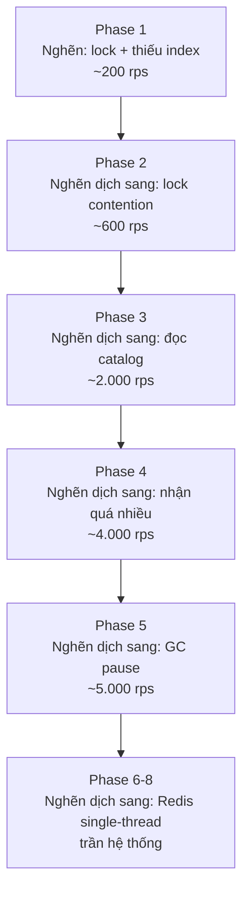

# Bản đồ bottleneck

Đây là bản đồ của cả dự án: mỗi phase tấn công một nghẽn khác nhau.

## Nghẽn dịch chuyển như thế nào

Sửa một nghẽn thì nghẽn lộ ra ở chỗ khác. Đây là điều quan trọng nhất cần hiểu:

Con số là **dự đoán**, không phải cam kết. Việc của bạn là đo xem thực tế khác bao nhiêu —
và chỗ khác nhiều nhất chính là chỗ bạn hiểu sai hệ thống.

## Nhận diện nghẽn qua Grafana

| Nghẽn | Dấu hiệu | Dashboard |
|---|---|---|
| Thiếu index / N+1 | DB query time cao + QPS cao bất thường | db-redis |
| Pool cạn | `hikaricp_connections_pending > 0` | db-redis |
| Lock contention | p99 **tăng tuyến tính** theo số VU | red |
| Cache miss | hit rate thấp + DB QPS cao | db-redis |
| Quá tải | queue depth tăng không ngừng, timeout cascade | business |
| GC | p99 **răng cưa** đúng nhịp GC pause | jvm |
| Shared bottleneck | thêm instance mà throughput phẳng | red |

**Mẹo đọc:** p99 tăng *tuyến tính* theo tải = tranh chấp (lock, single thread).
p99 *nhảy bậc* = tài nguyên cạn (pool, memory). p99 *răng cưa* = GC hoặc job định kỳ.
