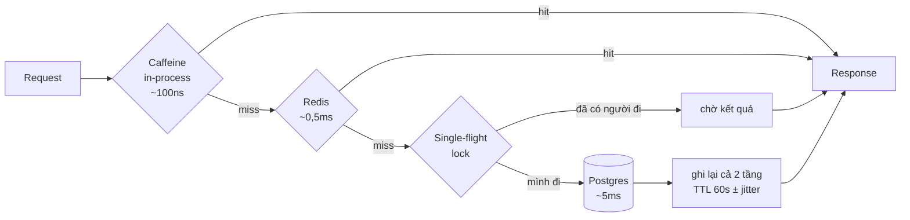
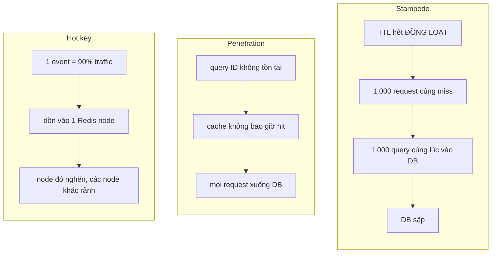

# Cache 2 tầng (Phase 4)



## Vì sao 2 tầng chứ không phải 1

| | Caffeine | Redis |
|---|---|---|
| Độ trễ | ~100ns | ~500µs (×5000) |
| Phạm vi | 1 instance | chia sẻ 4 instance |
| Dung lượng | heap JVM | RAM riêng |
| Mất khi restart | có | không |
| Hot key | **giải quyết được** | vẫn dồn vào 1 node |

Caffeine giải quyết hot key: 1 event chiếm 90% traffic thì mỗi instance giữ bản sao riêng,
Redis không phải nhận 90% lưu lượng đó.

Cái giá: 4 instance có thể giữ 4 bản khác nhau trong ≤ TTL. Với catalog thì chấp nhận được,
với `stock` thì **không** — nên `stock` không bao giờ cache ở Caffeine.

## Ba vấn đề và cách đo



| Vấn đề | Cách sửa | Cách đo hiệu quả |
|---|---|---|
| Stampede | single-flight lock **hoặc** probabilistic early expiration | DB QPS tại thời điểm TTL hết |
| Penetration | negative cache + bloom filter | DB QPS với 100% ID không tồn tại |
| Hot key | Caffeine local + TTL jitter | phân bố ops/s giữa các Redis node |

**Cách gây stampede để test:** `FLUSHDB` giữa lúc `load.js` đang chạy 500 VU, rồi xem
DB QPS trên Grafana. Không thấy đỉnh nhọn là chưa test đúng.

## TTL jitter

```
TTL = 60s + random(0, 15s)
```

Không có jitter: 1.000 key nạp cùng lúc → hết hạn cùng lúc → stampede lặp lại mỗi 60s.
Có jitter: trải ra 15s → DB nhận tải đều.

Một dòng code, loại bỏ hẳn một lớp vấn đề. Đây là loại tối ưu đáng làm trước tiên.
