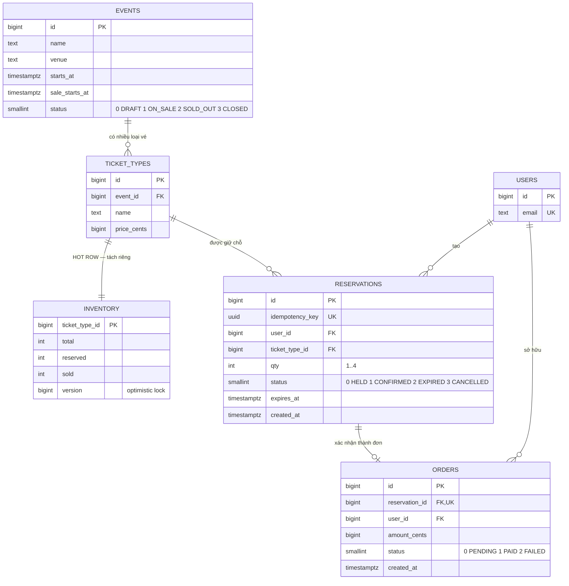

# ERD

## Hai điểm đáng chú ý trên ERD

**`TICKET_TYPES ||--|| INVENTORY` là 1-1** — nhìn qua thì vô lý, sao không gộp vào một bảng?

Vì `ticket_types` được **đọc** rất nhiều (name, price — gần như không đổi) còn `inventory`
được **ghi** rất nhiều (counter). Gộp lại thì mỗi `UPDATE reserved` tạo row version mới,
làm bẩn cache và chặn request đang đọc `price`. Tách ra là tối ưu, không phải chuẩn hoá.

**`RESERVATIONS ||--o| ORDERS` là 1-0..1** với `UNIQUE(reservation_id)` — một giữ chỗ sinh
tối đa một đơn. Đây là chốt chống tạo 2 đơn từ 1 giữ chỗ, ở tầng DB.

Chi tiết DDL: [../02-design/data-model.md](../02-design/data-model.md)
