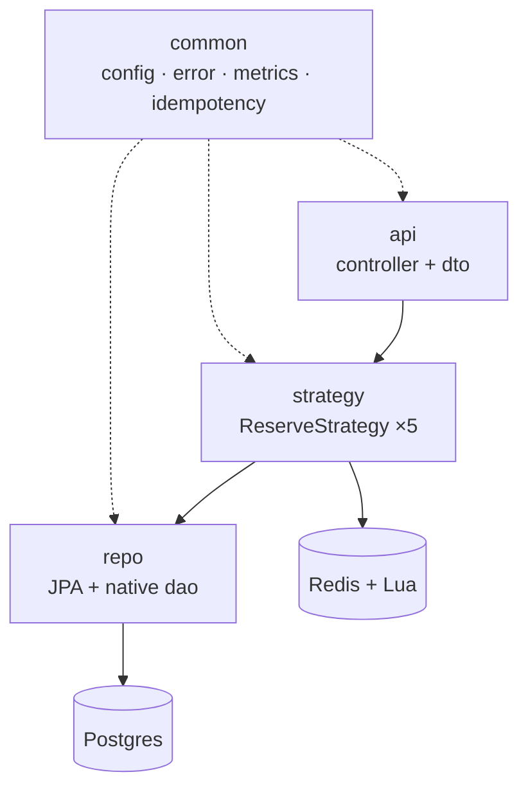
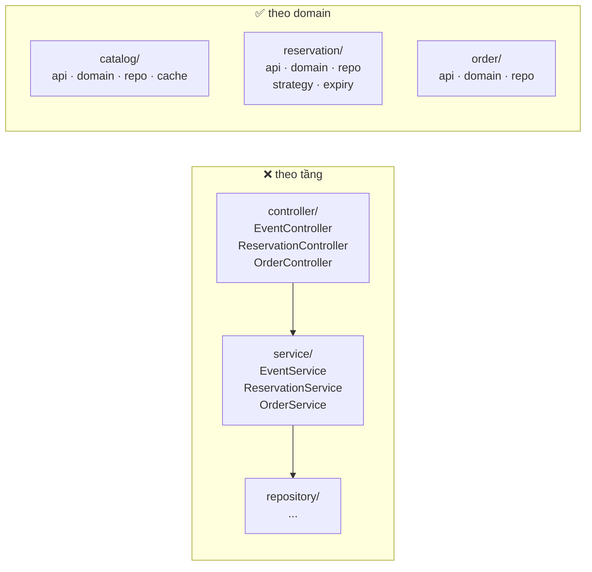

# Phụ thuộc giữa package backend

## Quy tắc

| Quy tắc | Vì sao |
|---|---|
| `common` không phụ thuộc domain nào | nếu có, nó thành thùng rác và mọi thứ phụ thuộc chéo |
| `catalog` và `reservation` không gọi nhau | hai đường đi (đọc/ghi) phải độc lập để tối ưu riêng |
| `api` → `strategy` → `repo`, không bao giờ `api` → `repo` | giữ hot path đi qua đúng một điểm đo |

## Tổ chức theo domain, không theo tầng

Lý do cụ thể cho dự án này: khi profiler chỉ vào `reservation/`, bạn biết ngay phải đọc gì.
Với cách chia theo tầng, một thay đổi ở hot path phải sửa 3 thư mục cách xa nhau, và không
có chỗ nào tự nhiên để đặt `strategy/`.

Cấu trúc đầy đủ: [../../ROADMAP.md](../../ROADMAP.md)
