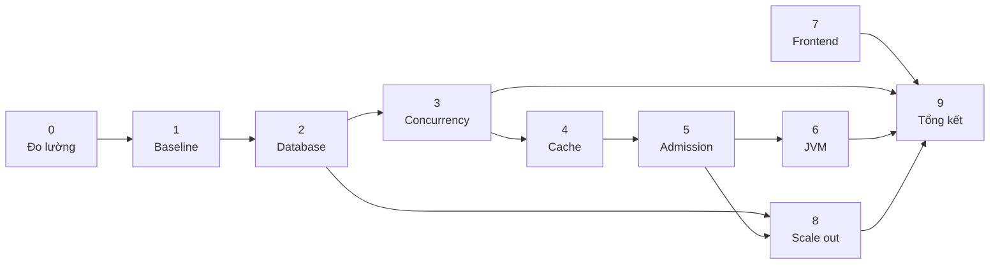
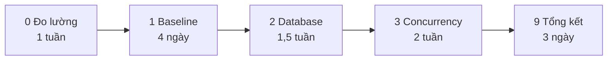

# Phụ thuộc giữa các phase

## Vì sao thứ tự này

| Quy tắc | Lý do |
|---|---|
| 0 trước tất cả | Không đo được thì mọi thứ sau là đoán |
| 1 trước 2 | Phải có baseline tệ để so sánh |
| 2 trước 3 | Sửa index trước khi sửa lock — nếu không, lock contention bị index chậm che mất |
| 3 trước 4 | Cache che mất lock contention → không học được gì về concurrency |
| 4 trước 5 | Phải biết công suất thật mới đặt được ngưỡng load shedding |
| 6 gần cuối | JVM tuning là 5-10% cuối. Làm sớm thì tối ưu nhầm chỗ |
| 7 độc lập | Frontend không phụ thuộc backend đã tối ưu hay chưa |
| 9 cuối | Cần đủ số liệu để tổng kết |

**Sai lầm phổ biến nhất:** nhảy vào Phase 6 (GC flag) ngay từ đầu vì nó "nghe giống tối ưu".
Thực tế bottleneck ở Phase 1 là lock và index — tune GC lúc đó không đổi được gì.

## Đường tối giản (~5,5 tuần)

Bỏ 4-8 vẫn là dự án tốt. Bỏ 0 hoặc 9 thì dự án mất hết giá trị học tập.
