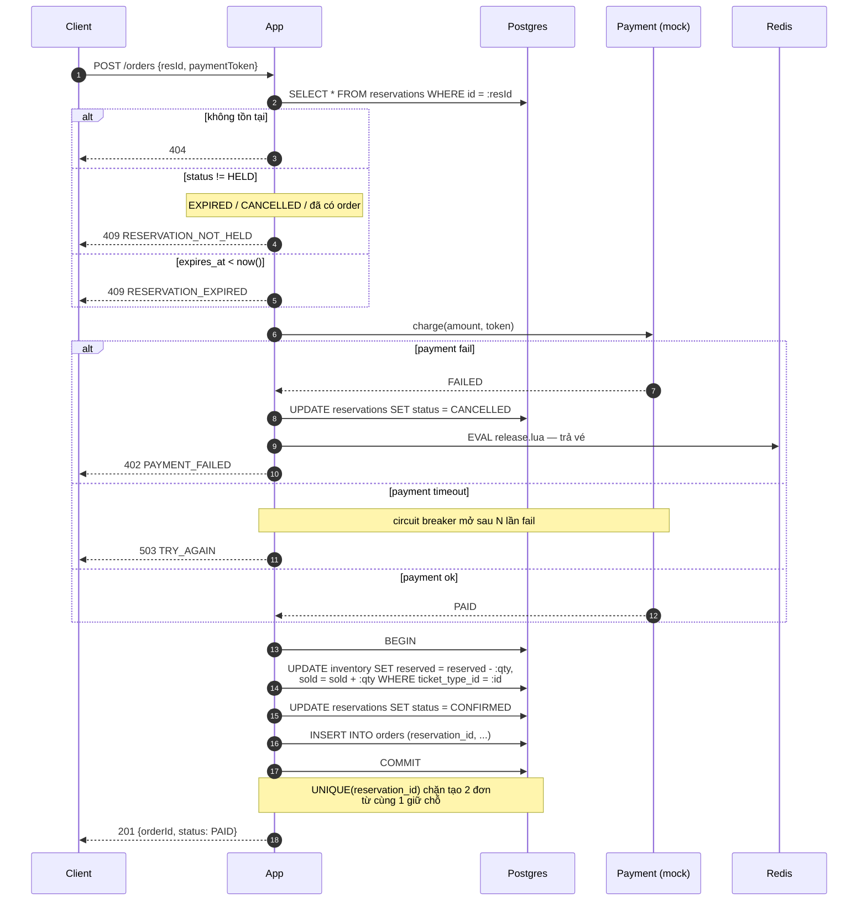

# Luồng xác nhận đơn

Chuyển `HELD` → `CONFIRMED` và tạo order.



## Vì sao `reserved--` và `sold++` cùng lúc

Invariant là `reserved + sold <= total`. Chuyển một vé từ "đang giữ" sang "đã bán" phải
**giữ nguyên tổng** — nếu làm hai câu lệnh riêng thì giữa chúng invariant bị phá tạm thời,
và một reservation khác chen vào sẽ thấy trạng thái sai.

Một `UPDATE` duy nhất, một transaction. Không tách.

## Bẫy: payment chậm

`paymentToken: "mock_slow"` sleep 2s. Nếu không có timeout:

```
2s × 1.000 request đồng thời = 1.000 connection bị giữ 2s
→ pool cạn → toàn bộ API chết, kể cả GET /events
```

Đây là lý do Phase 5 đặt **timeout ở mọi call ra ngoài** + bulkhead tách pool cho payment.
Một dependency chậm không được làm chết cả hệ thống.
