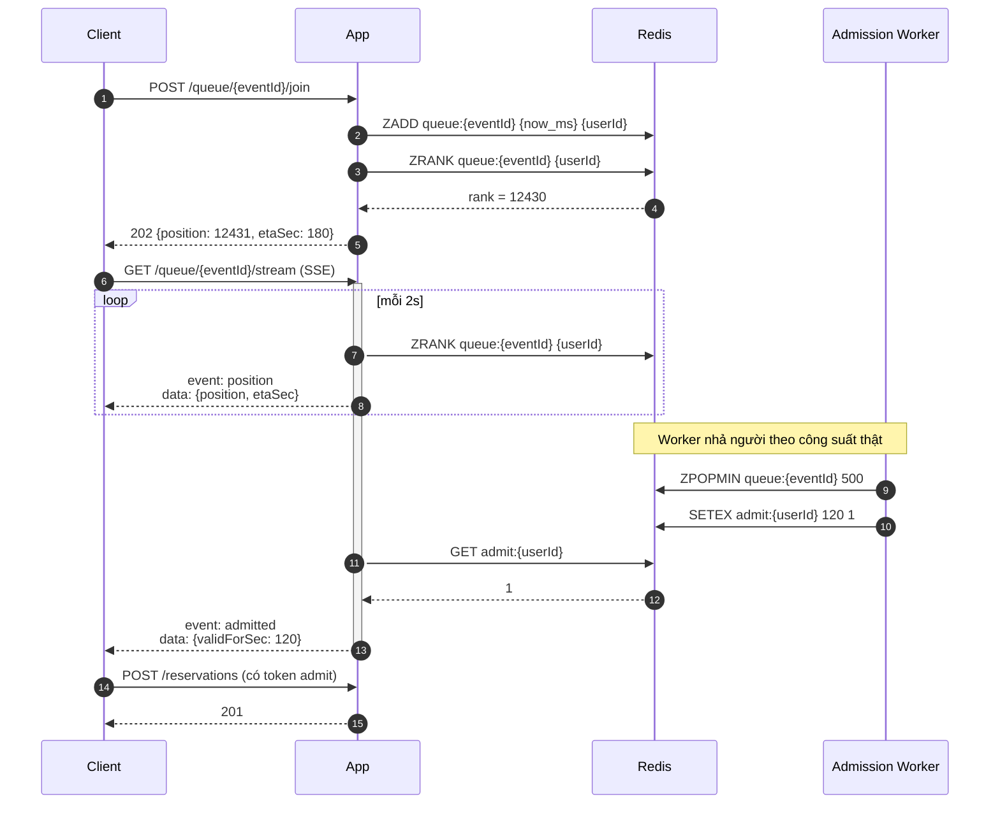

# Hàng chờ ảo (Phase 5)

Khi 50.000 người vào cùng lúc mà hệ thống chỉ xử lý được 5.000 rps, lựa chọn không phải
"nhận hết hay từ chối hết" mà là **xếp hàng có thông tin**.



## Tốc độ nhả người = công suất đo được, không phải con số đoán

```
nhả_mỗi_giây = throughput_đo_được × 0,8      ← chừa 20% dự phòng
```

Lấy từ chính Prometheus (`rate(reservation_attempts_total[1m])`), không hardcode. Nếu
hardcode thì khi hệ thống chậm đi (GC, DB chậm) worker vẫn nhả đều → quá tải → sập.

Đây là **backpressure**: tín hiệu từ nơi chậm ngược lên nơi điều phối.

## ETA tính thế nào

```
etaSec = position / nhả_mỗi_giây
```

Thà cho ETA thô mà có, hơn là không có gì. Người dùng chờ 3 phút **biết mình đang chờ 3 phút**
sẽ không F5 liên tục — và F5 liên tục chính là thứ nhân đôi tải.

Đây là tối ưu **hành vi người dùng**, không phải tối ưu code. Hiệu quả thường lớn hơn.

## SSE vs polling — đo ở Phase 7

| | Polling 2s | SSE |
|---|---|---|
| Request/phút/user | 30 | 1 (giữ kết nối) |
| Băng thông 50k user | ~25.000 req/s chỉ để hỏi vị trí | ~0 |
| Connection giữ | 0 | 50.000 |
| Độ trễ cập nhật | ≤ 2s | ~0 |

SSE thắng về số request nhưng phải giữ 50.000 connection — đó là lý do cần virtual threads.
Với platform thread, 50.000 connection = 50.000 thread = ~50GB stack. Không khả thi.

**Đây là chỗ virtual thread thực sự thắng** — khác với Phase 3.5 nơi nó không giúp được gì
vì nghẽn nằm ở connection pool, không ở thread.
