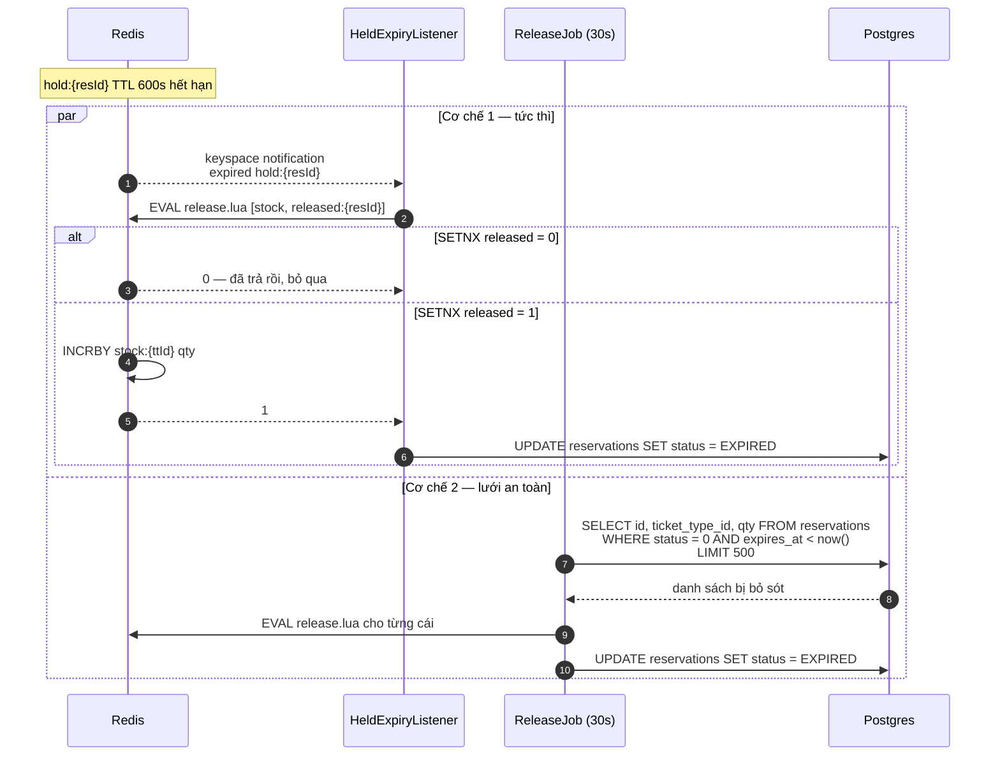
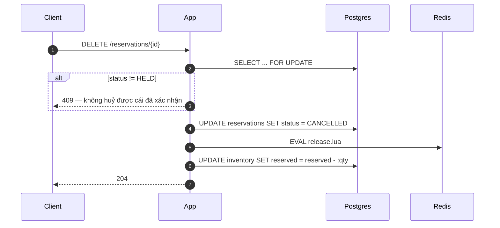

# Luồng trả vé — nơi bug trốn ★

Hai nhánh: hết hạn (`EXPIRED`) và huỷ (`CANCELLED`). Sai ở đây = **rò rỉ vé vĩnh viễn**,
mất doanh thu âm thầm mà không có lỗi nào xuất hiện trong log.

## Hai cơ chế song song — và vì sao cần cả hai



| Cơ chế | Độ trễ | Độ tin cậy |
|---|---|---|
| Keyspace notification | ~0ms | **best-effort** — Redis KHÔNG đảm bảo giao |
| `ReleaseJob` quét DB 30s | ≤ 30s | không mất, nhưng chậm |

Redis keyspace notification là fire-and-forget. Listener chết, mạng chập, Redis restart →
event mất. Chỉ dựa vào nó thì vé rò rỉ. Nên phải có job quét.

## Chốt `SETNX` — và cái bẫy nó giải quyết

Có hai cơ chế nghĩa là **cùng một vé có thể bị trả hai lần**:

```
Listener  trả vé → INCRBY stock +2
Job       trả vé → INCRBY stock +2     ← cùng reservation!
                   stock giờ nhiều hơn thực tế 2 vé
                   → OVERSELL
```

`SETNX released:{resId}` trong `release.lua` là chốt chống điều đó: ai vào trước thì trả vé,
ai sau thì bị từ chối.

**Đây là bài học quan trọng:** thêm cơ chế thứ hai cho *đáng tin cậy hơn* lại sinh ra một
đường *oversell mới*. Mọi tối ưu về độ tin cậy đều có thể phá invariant — phải kiểm lại.

Metric `release_duplicate_total` đếm số lần `SETNX` chặn. Giá trị > 0 là **bình thường**,
nó chứng tỏ chốt đang làm việc.

## Nhánh huỷ chủ động



## Test bắt buộc

| Test | Kiểm điều gì |
|---|---|
| `ExpiryReleaseTest` | hết hạn → vé về kho, đúng số lượng |
| trả vé 2 lần | `SETNX` chặn, `stock` không phình |
| kill listener → job gánh | không rò rỉ vé |
| kill Redis lúc đang trả | sau khi Redis lên, reconciliation phát hiện và sửa |

Chi tiết: [../07-testing/invariants.md](../07-testing/invariants.md)
