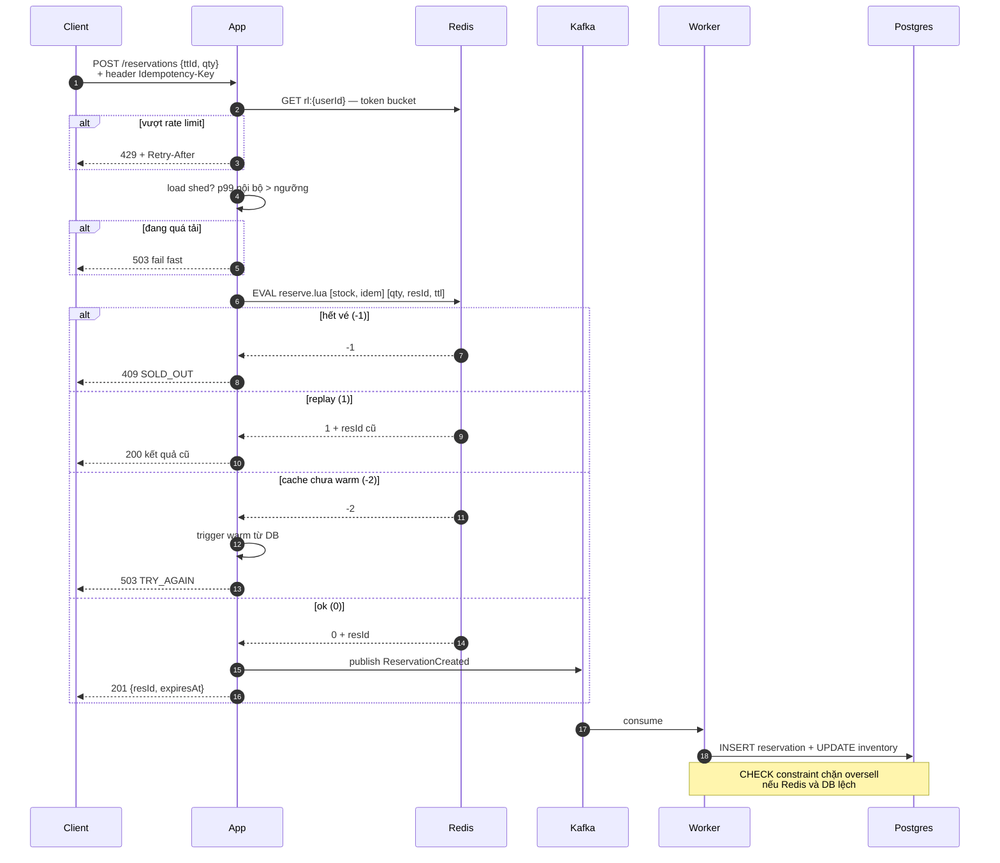
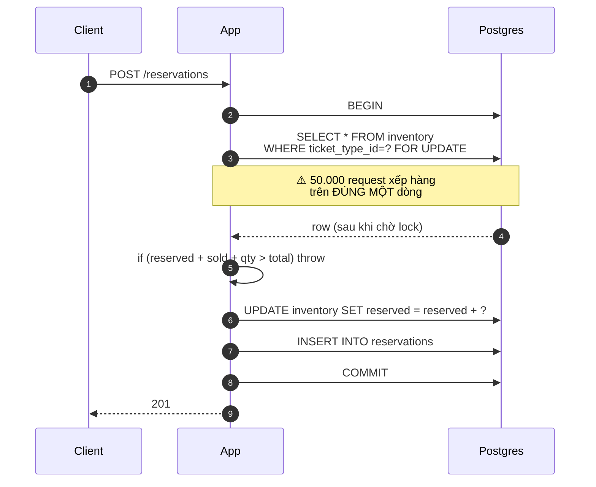
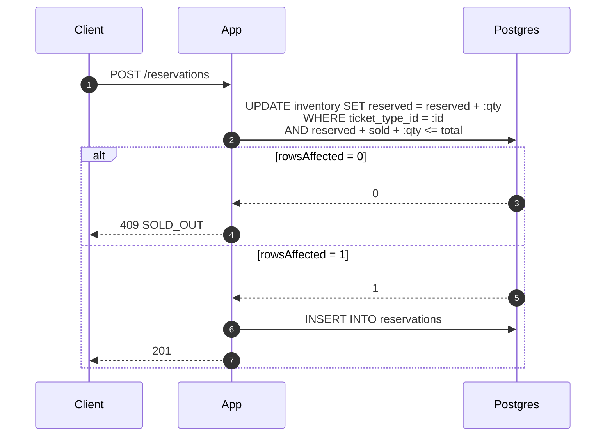

# Luồng giữ chỗ — hot path ★

Đây là đường đi được tối ưu suốt cả dự án. Mọi phase đều chạm vào nó.

## Đích (sau Phase 5)

**Điểm then chốt:** client nhận `201` ở bước 18 — **trước khi** DB ghi xong ở bước 20.
Đổi latency lấy consistency. Cái giá là bắt buộc phải có reconciliation job.

## So sánh: Phase 1 (ngây thơ)

4 round-trip trong một transaction giữ lock. Pool connection bị chiếm ~50ms mỗi request
→ cần pool 250 để đạt 5.000 rps → vượt `max_connections` của Postgres.

Tính toán: [../02-design/capacity.md](../02-design/capacity.md)

## Phase 3.3 — atomic UPDATE (winner ở tầng DB)

Một câu lệnh, không round-trip, lock cực ngắn, invariant nằm ngay trong `WHERE`.
Từ 4 round-trip xuống 2, thời gian giữ connection từ ~50ms xuống ~2ms.
