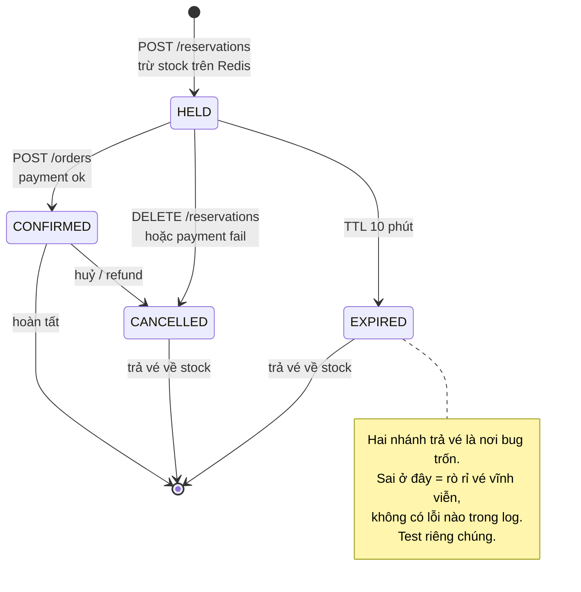
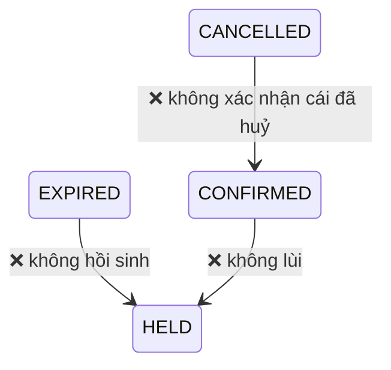

# Vòng đời Reservation

## Bảng chuyển trạng thái

| Từ | Đến | Trigger | Tác dụng lên inventory |
|---|---|---|---|
| — | `HELD` | `POST /reservations` | `reserved += qty` |
| `HELD` | `CONFIRMED` | payment ok | `reserved -= qty`, `sold += qty` |
| `HELD` | `EXPIRED` | TTL 10 phút | `reserved -= qty` |
| `HELD` | `CANCELLED` | huỷ / payment fail | `reserved -= qty` |
| `CONFIRMED` | `CANCELLED` | refund | `sold -= qty` |

Mọi chuyển trạng thái phải **giữ nguyên** `reserved + sold <= total`. Chuyển
`HELD → CONFIRMED` là trường hợp duy nhất đổi cả hai cột — phải trong **một** câu UPDATE.

## Trạng thái cuối và bất biến

| Trạng thái | Cuối? | `reserved + sold` |
|---|---|---|
| `HELD` | không | tính vào `reserved` |
| `CONFIRMED` | có | tính vào `sold` |
| `EXPIRED` | có | không tính |
| `CANCELLED` | có | không tính |

## Chuyển trạng thái KHÔNG được phép

Kiểm tra ở hai nơi: guard trong service, và `WHERE status = 0` trong câu `UPDATE`
(làm cho chuyển trạng thái sai thành `rowsAffected = 0` chứ không âm thầm ghi đè).
