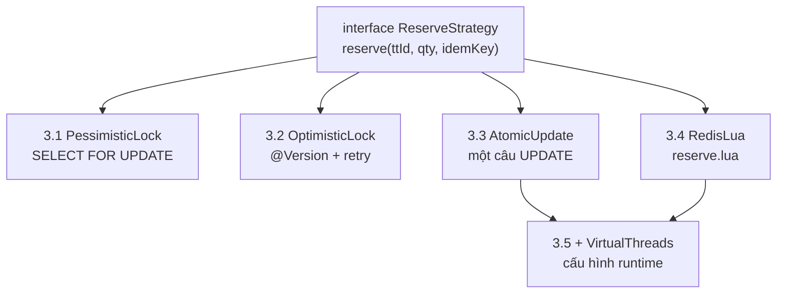
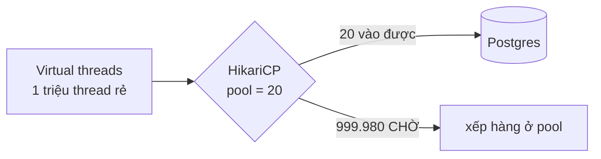

# 5 chiến lược giữ chỗ (Phase 3)

Một interface, 5 implementation, đổi bằng config → A/B được dưới **cùng một lần k6**.

`app.reserve.strategy=atomic-update` trong `application.yml`.

## Dự đoán trước khi đo

Viết dự đoán **trước**, rồi so với thực tế. Chỗ lệch nhiều nhất là chỗ bạn hiểu sai hệ thống.

| # | Chiến lược | Throughput dự kiến | p99 dự kiến | Vì sao |
|---|---|---|---|---|
| 3.1 | Pessimistic | ~200 rps | > 5s | mọi request serialize trên 1 row |
| 3.2 | Optimistic | ~150 rps | > 8s | contention cao → bão retry, **tệ hơn 3.1** |
| 3.3 | Atomic UPDATE | ~2.000 rps | ~50ms | 1 round-trip, lock cực ngắn |
| 3.4 | Redis Lua | ~8.000 rps | ~5ms | không chạm DB trên hot path |
| 3.5 | + Virtual threads | **không đổi đáng kể** | — | nghẽn ở pool, không ở thread |

Dự đoán 3.2 tệ hơn 3.1 là phản trực giác — "optimistic nhanh hơn pessimistic" chỉ đúng khi
contention **thấp**. Ở đây 50.000 request tranh 1 row, retry rate gần 100%.

## 3.5 không phải một strategy

Virtual threads là **cấu hình runtime**, áp lên 3.3 hoặc 3.4. Đo riêng để thấy:

Thread không còn là nghẽn, nhưng **connection pool vẫn là**. Virtual thread chỉ chuyển
chỗ xếp hàng từ thread pool sang connection pool.

Nó thắng ở chỗ khác: giữ 50.000 SSE connection cho hàng chờ
([sequence-queue.md](sequence-queue.md)).

## Kết quả thật ghi ở đâu

`results/phase-03-concurrency/strategy-comparison.md` — bảng so sánh + biểu đồ + kết luận
chọn cái nào và tại sao (gồm cả đánh đổi độ phức tạp, không chỉ con số).
