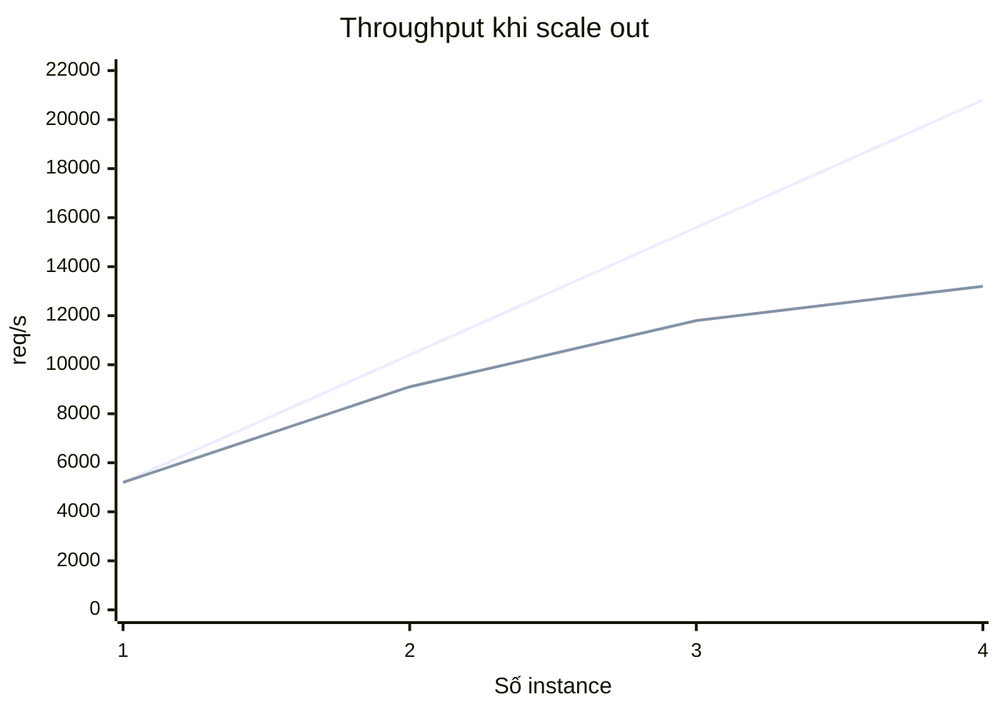

# Phase 8 — Scale Out & Resilience

`1 tuần` · bỏ được

## Mục tiêu

Scale 1 → 4 instance, và **giải thích bằng số liệu** đâu là shared bottleneck chặn phần
tăng tuyến tính.

## Câu hỏi trung tâm

```
1 instance = 5.000 rps
→ 4 instance = 20.000 rps?
```

**Không.** Và việc chỉ ra *chính xác cái gì* tạo ra khoảng cách mới là nội dung của phase này.



Đường trên = tuyến tính lý tưởng. Đường dưới = thực tế (dự đoán).

## Tài nguyên chia sẻ — thủ phạm

| Tài nguyên | Chia sẻ? | Giới hạn |
|---|---|---|
| CPU app | không | scale tuyến tính |
| **Redis** | **có** | single-thread, ~100k ops/s |
| **PG primary** | **có** | 12 core, `max_connections` |
| Kafka partition | **có** | song song = số partition |

Redis single-thread là nghẽn chia sẻ rõ nhất: mỗi request 2 lệnh Redis → `100k / 2 = 50.000 rps`
là **trần lý thuyết của toàn hệ thống**. Phase này kiểm chứng con số đó.

Tính toán: [../../02-design/capacity.md](../../02-design/capacity.md)

## Bẫy stateless

4 instance làm lộ ra những thứ Phase 1-7 không thấy:

| Vấn đề | Biểu hiện |
|---|---|
| **Scheduled job chạy 4 lần** | `ReleaseJob` trả vé 4 lần → `SETNX` cứu, nhưng tốn 4× tài nguyên |
| Cache local 4 bản khác nhau | catalog lệch nhau ≤ TTL (chấp nhận được) |
| Session in-memory | user mất đăng nhập khi nginx route sang instance khác |
| **Pool nhân 4** | 4 × 20 = 80 connection — `max_connections` chịu nổi? |
| `avg(p99)` giữa 4 instance | con số vô nghĩa — phải dùng histogram |

Cái cuối là lý do Phase 0 bắt buộc dùng histogram chứ không phải summary.

## Bài học kỳ vọng

- **Amdahl's Law** / **Universal Scalability Law** bằng số liệu của chính bạn
- Scale ngang chỉ giúp phần **không chia sẻ**; phần chia sẻ phải tối ưu hoặc shard
- Phát hiện shared bottleneck: thêm instance mà throughput phẳng, và tài nguyên nào đạt 100%
- Partition pruning: query theo khoảng thời gian nhanh hơn bao nhiêu
